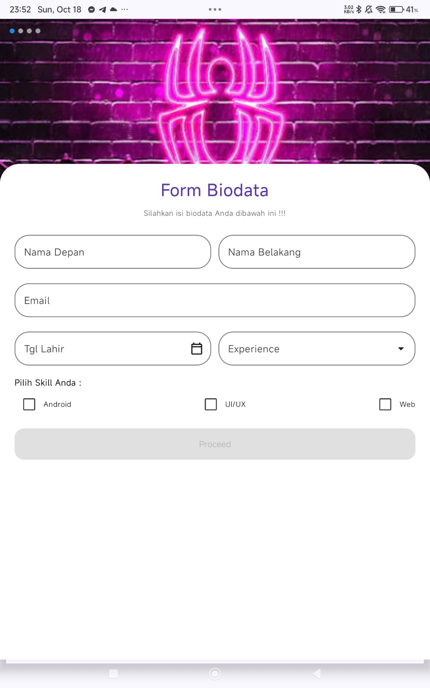
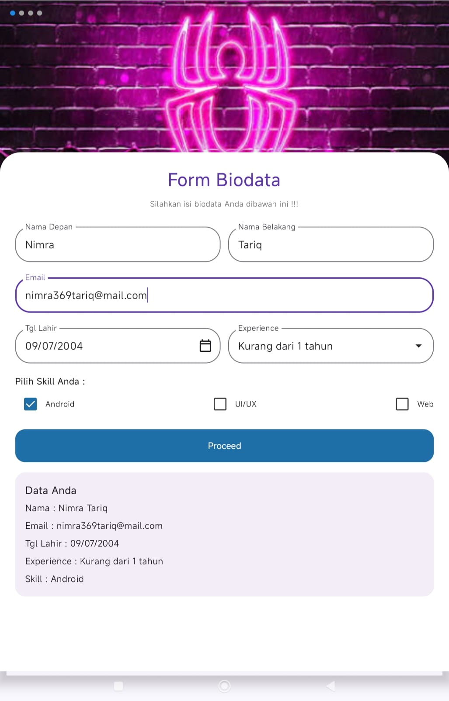

# QuestTugasUserInput_0146

A Jetpack Compose biodata form. The white card floats over the header image inside a Scaffold. The Proceed button stays disabled until every field is filled and at least one skill is checked. After pressing it, a box under the button shows the data that was entered.

## Rules followed
- All texts, colors and sizes are in the resources (strings.xml, colors.xml, dimens.xml)
- The header image and the two icons are in res/drawable
- No hardcoded values in the screen code

## Result
Empty form, Proceed is disabled:

Filled form, after pressing Proceed:

